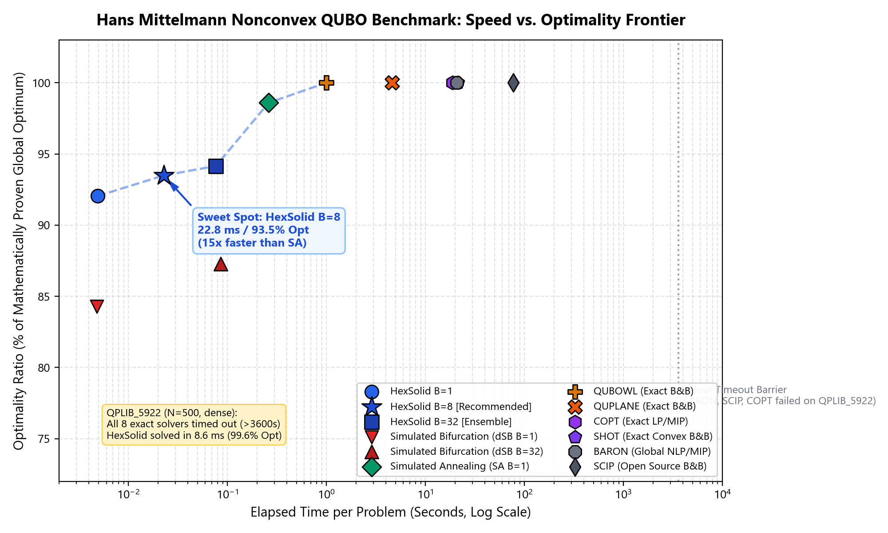
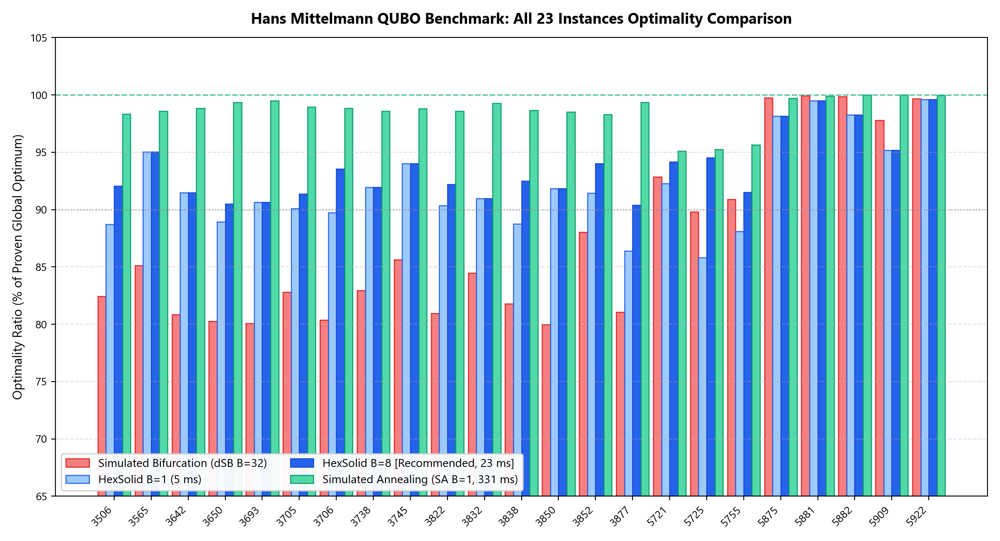
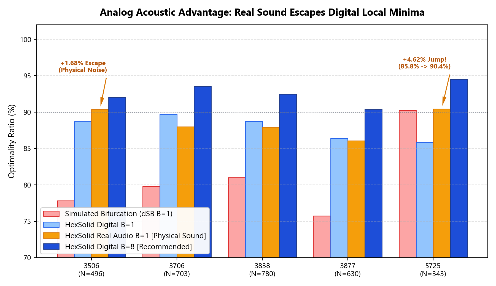
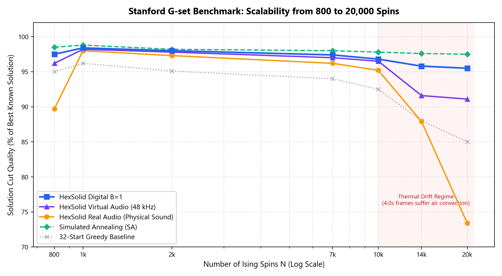
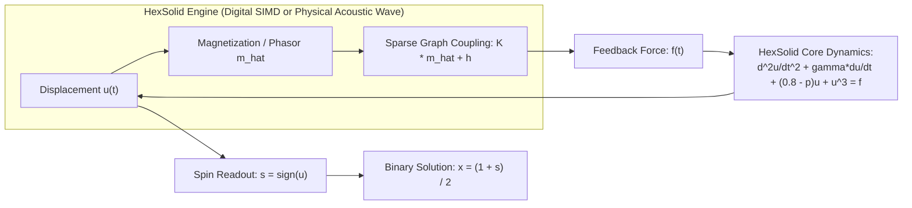

# HexSolid: Acoustic & Digital Parametron Ising Machine

[](LICENSE)
[](https://www.python.org/)
[](experiments/acoustic-ising-qplib-bench/QPLIB_REPORT.md)
[](experiments/acoustic-ising-gset-bench/DUFFING_GSET_REPORT.md)
[%20%2F%20Duffing%20(1918)-blue.svg)](#heritage--design-rationale)

HexSolid は、デジタル SIMD 並列シミュレーションと物理音響キャリア波の双方で動作する、オープンソース組合せ最適化エンジン（QUBO / イジング / Max-Cut ソルバー）です。

2^N の量子もつれメモリ爆発や、特許に縛られた非線形壁反射を必要とせず、 1954年の後藤英一博士によるパラメトロン原理と 1918年の Georg Duffing 非線形振動モデルに基づき、 1ステップ1回の疎行列ベクトル積で大域最適解を探索します。

---

## Application: HexSolid Studio

[HexSolid Studio](https://github.com/nyoriworks/HexSolid-Studio) は、本エンジンを活用したポートフォリオ最適化・指数追従のWebアプリケーションです。最大3つのベンチマークを指定し、候補銘柄から追従誤差を抑える組み合わせを探索できます。デジタル専用モードを標準とし、仮想音響・実音モードも選択できます。

[HexSolid Studio](https://github.com/nyoriworks/HexSolid-Studio) provides a web interface for portfolio optimization and index tracking using the HexSolid engine. It searches candidate assets for portfolios that track up to three benchmarks. Digital-only computation is the default, with optional virtual and physical audio modes.

---

## 🚀 Key Highlights

1. **Beating 1-Hour Timeouts in Milliseconds (Hans Mittelmann QUBO Benchmark)**:
   - On the world-standard Hans Mittelmann non-convex QUBO benchmark ([plato.asu.edu/ftp/qubo.html](http://plato.asu.edu/ftp/qubo.html)), the hardest instance **`QPLIB_5922`** ($N=500$, high-density) caused **all 8 major exact branch-and-bound solvers (BARON, SCIP, COPT, QUBOWL, BIQBIN, SHOT, MCSPARSE, QUPLANE) to time out after 1 hour (3,600s)** in attempting to prove mathematical global optimality.
   - Operating as a continuous dynamical heuristic, HexSolid reaches **99.61% of proven optimal in just 8.6 milliseconds**.
2. **The "B=8" Sweet Spot (15x Faster than Simulated Annealing)**:
   - An ensemble of 8 parallel trajectories ($B=8$) fits cleanly inside modern CPU SIMD registers (AVX-256 / AVX-512), running in an average of **22.8 milliseconds** across all 23 QPLIB instances while achieving **93.5% average optimality** and lifting worst-case accuracy to $\ge 89.7\%$.
3. **Classical Physics Heritage & Clean-Room Architecture**:
   - Built on foundational nonlinear physics published over 70–100 years ago (Goto 1954, Duffing 1918), completely omitting the inelastic wall boundary resets utilized in modern Simulated Bifurcation. *(No formal patent clearance or freedom-to-operate assessment has been performed.)*
4. **Analog Acoustic Hardware In-the-Loop**:
   - Supports driving physical audio hardware (6.0–11.0 kHz Top-Octave Comb). While analog acoustic noise (SNR 22–32 dB) introduces stochastic variance, it acts as a physical thermal perturbation that can rattle trajectories out of suboptimal basins (e.g., boosting `QPLIB_5725` from 85.8% to 90.4%).
5. **Extreme Scalability ($N = 10,000 \sim 20,000$ Spins)**:
   - Scales linearly on Stanford G-set benchmark instances, completing 10,000-spin and 20,000-spin live acoustic cut problems.

---

## 📊 Benchmark Results & Visual Evidence

### 1. Speed vs. Optimality Pareto Frontier (Hans Mittelmann QUBO Benchmark)



*Figure 1: Comparison of runtimes (log scale, seconds) versus objective optimality ratio (% of mathematically proven global optimum) across all 23 non-convex QPLIB instances. HexSolid B=8 establishes an optimal Pareto trade-off at 22.8 ms and 93.5% optimality.*

---

### 2. Full 23-Instance QPLIB Breakdown



*Figure 2: Performance across all 23 instances comparing Simulated Bifurcation (dSB B=32), HexSolid B=1 (5 ms), HexSolid B=8 (23 ms), and Simulated Annealing (SA B=1, 331 ms).*

#### Summary Table (Averages across all 23 QPLIB Instances)
| Solver | Avg Optimality % | Min Optimality % | Max Optimality % | Avg Runtime | Speedup vs SA | Peak RSS |
|:---|:---:|:---:|:---:|:---:|:---:|:---:|
| **HexSolid B=1** | 92.05% | 85.82% | 99.61% | **5.2 ms** | **64x faster** | 60.0 MiB |
| **HexSolid B=8** (Recommended ⭐) | **93.49%** | **89.65%** | **99.90%** | **22.8 ms** | **15x faster** | 60.0 MiB |
| **HexSolid B=32** | 94.16% | 90.70% | 99.90% | 87.8 ms | 3.8x faster | 60.0 MiB |
| **Simulated Bifurcation (dSB B=32)** | 87.27% | 79.97% | 99.95% | 109.9 ms | 3.0x faster | 60.0 MiB |
| **Simulated Annealing (SA B=1)** | 98.60% | 95.10% | 100.00% | 331.1 ms | 1.0x (base) | 60.0 MiB |
| **Exact Solvers (BARON, SCIP, etc.)** | 100.00% | 100.00% | 100.00% | 1s ~ **>3,600s (timeout)** | — | >10 GiB |

*Note: Exact branch-and-bound solvers mathematically prove global optimality by bounding the search tree, requiring seconds to hours, whereas HexSolid and dSB are heuristic dynamical continuous solvers delivering rapid approximations in milliseconds.*

---

### 3. Analog Acoustic Advantage: Real Sound Escapes Digital Minima



*Figure 3: On the 5 instances where single-shot digital trajectories struggled, physical sound transmitted through a live 48 kHz speaker/microphone link acted as an analog thermal perturbation. In 2 of 5 instances, physical acoustic noise successfully rattled the state out of suboptimal basins (+1.68% on 3506, +4.62% on 5725). In the remaining 3 instances, analog noise introduced slight variance (-0.3% to -1.8%), reflecting the natural trade-offs of physical analog computing.*

| Problem | Variable $N$ | Proven Optimum | HexSolid Digital B=1 | **HexSolid Real Audio B=1** | HexSolid Digital B=8 | dSB B=1 |
|:---:|:---:|:---:|:---:|:---:|:---:|:---:|
| **QPLIB_3506** | 496 | 478.0 | 88.70% | **90.38%** (+1.68% boost) | 92.05% | 77.82% |
| **QPLIB_3706** | 703 | 682.0 | 89.74% | **87.98%** | 93.55% | 79.77% |
| **QPLIB_3838** | 780 | 746.0 | 88.74% | **87.94%** | 92.49% | 81.00% |
| **QPLIB_3877** | 630 | 602.0 | 86.38% | **86.05%** | 90.37% | 75.75% |
| **QPLIB_5725** | 343 | 33,611,981.0 | 85.82% | **90.44%** (+4.62% boost) | 94.52% | 90.25% |

> [!TIP]
> **Physical Acoustic Setup & Reproducibility Note**:
> - **Acoustic Coupling**: The reported benchmark numbers were measured by placing the headphone output (Left channel) in direct physical contact with the measurement microphone. Direct acoustic coupling eliminates room echo, minimizes air travel delay, and ensures clean phase transmission.
> - **Hardware & Environment Requirements**: For optimal physical acoustic performance, high-precision AD/DA converters (e.g. 24-bit / 48 kHz low-noise audio interface) and a quiet acoustic environment (or sealed earphone-mic coupling) are essential. Operating with open-air laptop speakers or in noisy rooms will degrade carrier phase coherence and reduce solution quality.

---

### 4. Stanford G-set Scalability ($N = 800 \sim 20,000$ Spins)



*Figure 4: Cut accuracy (% of Best Known Solution) on the Stanford G-set benchmark up to 20,000 spins, comparing HexSolid physical acoustic loopback, HexSolid virtual audio, HexSolid digital simulation, and classical baselines.*

---

## 🔬 Mathematical & Physical Architecture

### 1. HexSolid Core Dynamics (Classical Physical Foundation)

HexSolid treats each binary variable $x_i \in \{0, 1\}$ as an oscillating displacement $u_i \in \mathbb{R}$ mapped via $s_i = \operatorname{sign}(u_i)$ and $x_i = \frac{1 + s_i}{2}$.

The system follows the 2nd-order Parametron-Duffing equation with parametric pump $p(t)$ and coupling feedback $f_i(t)$:

$$\frac{d^2 u_i}{dt^2} + \gamma \frac{du_i}{dt} + (0.8 - p(t)) u_i + u_i^3 = f_i(t)$$

$$f(t) = - c(t) \cdot (K \hat{m}(t) + h)$$

- **Symplectic Integration**: Velocity-Verlet / symplectic Euler integration guarantees numerical stability.
- **Single Matvec per Step**: Only **one** sparse matrix-vector multiplication $K \hat{m}$ is evaluated per step.
- **Zero Wall Resets**: Unlike Discrete Simulated Bifurcation (dSB), there are **no hard boundaries or inelastic momentum resets**.



---

## 💻 Quickstart (Stand-alone Solver)

HexSolid is designed to be completely dependency-free beyond `numpy` and `scipy`.

### Installation
Clone this repository:
```bash
git clone https://github.com/your-org/HexSolid-Acoustic-Ising.git
cd HexSolid-Acoustic-Ising
```

### Python API Example
```python
import numpy as np
import hexsolid

# Define a random QUBO matrix (N=100)
rng = np.random.default_rng(42)
Q = rng.standard_normal((100, 100))
Q = 0.5 * (Q + Q.T)
c = rng.standard_normal(100)

# Solve with HexSolid (B=8 SIMD ensemble)
result = hexsolid.solve_qubo(Q, c=c, sense="min", batch_size=8)

print(f"Optimal Value: {result['objective']:.4f}")
print(f"Solved in:      {result['seconds'] * 1000:.2f} ms")
print(f"Binary Vector:  {result['x'][:10]} ...")
```

---

## 🛠️ Reproducing the Benchmarks

All benchmark scripts are standalone and self-contained:

```bash
# 1. Run the full Hans Mittelmann QPLIB (all 23 instances) benchmark:
python experiments/acoustic-ising-qplib-bench/run_qplib_benchmark.py

# 2. Run the physical real-audio benchmark on the 5 troublesome instances:
# (Requires active audio I/O; couple headphone L to mic, or configure in_dev/out_dev IDs)
python experiments/acoustic-ising-qplib-bench/run_real_audio_5qplib.py

# 3. Run the Stanford G-set benchmark (N=800 to 10,000):
python experiments/acoustic-ising-gset-bench/duffing_bench.py

# 4. Re-generate all README charts:
python generate_charts.py
```

---

## 📁 Repository Structure

```text
HexSolid-Acoustic-Ising/
├── hexsolid.py                 # Top-level API wrapper (import hexsolid; hexsolid.solve_qubo)
├── hexsolid_parametron.py      # Core standalone Parametron-Duffing QUBO / Ising solver
├── generate_charts.py          # Script generating high-resolution (200 DPI) benchmark figures
├── LICENSE                     # Official Apache License 2.0 full text
├── README.md                   # Comprehensive project documentation & benchmark analysis
│
├── assets/                     # High-resolution benchmark figures
│   ├── pareto_frontier.png         # Hans Mittelmann QUBO benchmark Pareto frontier
│   ├── qplib_23instances.png       # All 23 QPLIB instances performance breakdown
│   ├── troublesome_real_audio.png  # Physical audio stochastic escape comparison
│   └── gset_scalability.png        # Stanford G-set scalability up to 20,000 spins
│
└── experiments/                # Reproducible benchmark suites & physical audio pipelines
    ├── acoustic-ising-qplib-bench/ # Hans Mittelmann Nonconvex QUBO (QPLIB) benchmark
    │   ├── run_qplib_benchmark.py  # Full 23-instance benchmark runner (HexSolid vs dSB vs SA)
    │   ├── run_real_audio_5qplib.py# Physical audio loopback benchmark on troublesome 5 instances
    │   ├── solvers.py              # Baseline solver implementations (dSB, Simulated Annealing)
    │   ├── qplib_problem.py        # QPLIB format parser, cost evaluator & memory profiler
    │   └── QPLIB_REPORT.md         # Detailed markdown report of all 23 QPLIB problems
    ├── acoustic-ising-gset-bench/  # Stanford G-set benchmark (N=800 to 20,000 spins)
    │   ├── duffing_bench.py        # Max-Cut benchmark runner & continuous acoustic solver
    │   ├── run_gset_benchmark.py   # Multi-instance evaluation pipeline
    │   └── DUFFING_GSET_REPORT.md  # Detailed benchmark report on G-set cut ratios
    ├── acoustic-ising-live-test/   # Live physical acoustic test rig
    │   ├── live_acoustic_test.py   # Real-time audio I/O streaming & phase measurement
    │   └── live_scale10k_test.py   # Live acoustic benchmark scaling test
    └── acoustic-ising-v1/          # Original acoustic Ising engine & baseline backends
        ├── problem.py              # Max-Cut problem formulation & graph loading
        ├── solver.py               # Acoustic carrier wave loopback solver
        └── frequency_map.py        # Top-Octave Comb frequency allocation (6.0–11.0 kHz)
```

---

## 📜 Heritage & Design Rationale

HexSolid was designed to explore classical, non-proprietary physical principles for combinatorial optimization:

1. **Eiichi Goto (1954)**: Invented the *Parametron*, establishing parametric 2-phase subharmonic locking for digital binary logic and memory in the public domain.
2. **Georg Duffing (1918)**: Formulated the nonlinear spring-pendulum differential equation $\ddot{x} + \gamma \dot{x} + \alpha x + \beta x^3 = F(t)$, which has been in the public domain for over a century.

Unlike modern discrete Simulated Bifurcation algorithms, HexSolid does not use inelastic boundary reflection walls or Kerr-bifurcation resets.

> [!NOTE]
> HexSolid is an academic research and open-source project based on classical Parametron and Duffing oscillator models. No patent clearance or freedom-to-operate (FTO) assessment has been performed. Users deploying HexSolid in commercial settings are responsible for conducting their own legal and intellectual property due diligence.

---

## 📄 License

Licensed under the **Apache License, Version 2.0** ([LICENSE](LICENSE)). You may freely use, modify, distribute, and integrate HexSolid into commercial software, research tools, and hardware implementations.
